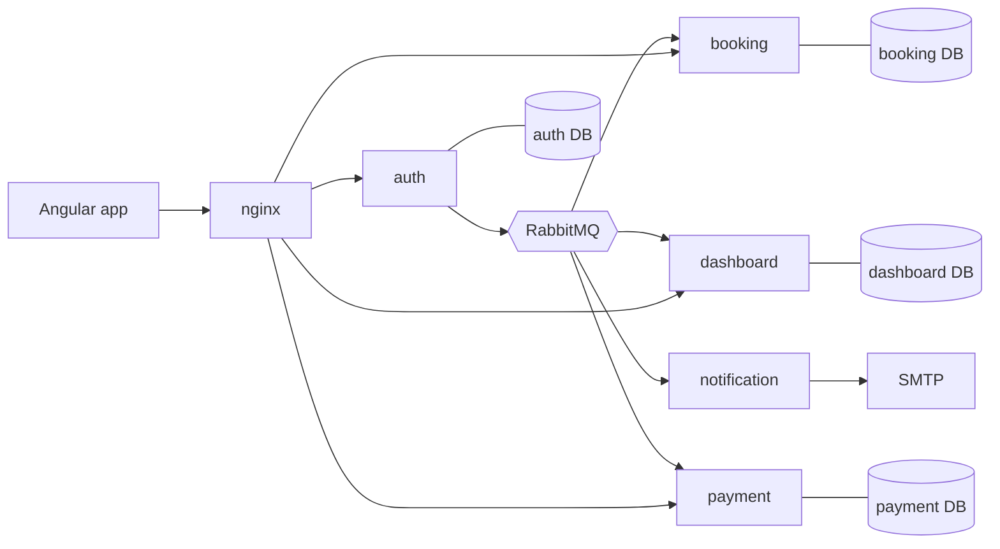

<!-- TODO(owner): add the Hospitia logo here, for example a copy of hospitia-frontend/clients/main/src/assets/logo/logo-full.png in docs/assets/. -->

# Hospitia

**Guest house management for NGOs.**
<!-- TODO(owner): confirm or replace the tagline. -->


Hospitia helps non-profit organizations run their guest houses: the properties, rooms and people behind them, in one accessible web application.

## What is Hospitia?

Many NGOs, trusts and community organizations offer rooms to pilgrims, volunteers, visiting staff or travellers, and manage them with registers, spreadsheets and phone calls. Hotel software is built for single, profit-driven hotels. Hospitia is built for organizations: each one manages its own guest houses, appoints managers, and sets up room types and rooms, while platform administrators look after the whole installation.

<!-- TODO(owner): describe who is behind Hospitia (organization, team) and the official mission statement. -->

Read more: [Vision and mission](docs/about/vision.md).

## Features

- **Accounts and roles:** admins, owners, managers and customers; sign-up, sign-in, email verification and password reset.
- **Organizations:** organization types, organizations with addresses, onboarding, and switching between several organizations.
- **Rooms:** currency units, default and organization-specific amenities, room types with capacity and price, and rooms with status.
- **People:** provision users for each role, with welcome emails; searchable listings.
- **Accessible by design:** WCAG AA and AXE checks, light and dark themes, large-text and high-contrast-focus preferences.
- **Built to operate:** one database per service, reliable events through a transactional outbox, structured logs in Grafana Loki, CI/CD with Jenkins.

Bookings, payments and reporting are next; see the [roadmap](docs/about/roadmap.md) and the [full feature list](docs/about/features.md).

<!-- TODO(owner): add screenshots of the dashboard and room setup pages, for example in docs/assets/screenshots/. -->

## Architecture at a glance



An Angular single-page app talks to FastAPI services. Each service owns its PostgreSQL database; services share data through events on RabbitMQ. Details: [Architecture](docs/architecture/index.md).

## Tech stack

| Area | Technology |
|---|---|
| Frontend | Angular 21, Angular Material 3, TypeScript, signals, Vitest, ESLint, Prettier |
| Backend | Python 3.13, FastAPI, SQLModel, Alembic, Pydantic, pika, uv, Ruff |
| Data and messaging | PostgreSQL 17, RabbitMQ |
| Development | VS Code dev container, Mailpit, PgAdmin, Claude Code cloud sessions |
| Operations | Docker, Jenkins (configuration as code), nginx, Grafana, Loki, Alloy |
| Documentation | MkDocs Material |

## Quick start

You need Docker, Git and VS Code (and WSL2 on Windows).

```bash
mkdir Project && cd Project
git clone https://github.com/smit9924/hospitia-master .
git clone https://github.com/smit9924/hospitia-frontend ./frontend
git clone https://github.com/smit9924/hospitia-backend ./backend
bash ./scripts/initial_setup.sh
```

Then create the `.env` files, open the folder in the dev container, migrate the databases and start the app: follow [Getting started](docs/getting-started/index.md). Take the [Product tour](docs/tutorials/product-tour.md) once it's running.

## Repositories

| Repository | Contains |
|---|---|
| [hospitia-master](https://github.com/smit9924/hospitia-master) (this one) | Workspace, dev container, CI/CD, server setup, scripts, agent rules and **documentation** |
| [hospitia-frontend](https://github.com/smit9924/hospitia-frontend) | Angular client apps (`clients/main`) |
| [hospitia-backend](https://github.com/smit9924/hospitia-backend) | FastAPI services: auth, booking, dashboard, payment, notification |

## Documentation

All documentation is in [`docs/`](docs/index.md). Preview it as a searchable site:

```bash
uv run --no-project --with-requirements docs/requirements.txt mkdocs serve
```

| Start with | For |
|---|---|
| [Getting started](docs/getting-started/index.md) | Setting up and running Hospitia locally |
| [Tutorials](docs/tutorials/index.md) | Learning the product and the code base step by step |
| [Architecture](docs/architecture/index.md) | How the system is built and why |
| [Guides](docs/guides/index.md) | Recipes for common development tasks |
| [Reference](docs/reference/index.md) | API, configuration, error codes, roles, ports |
| [Standards](docs/standards/index.md) | Coding, accessibility, Git and documentation rules |
| [Operations](docs/operations/index.md) | CI/CD, deployment, observability, releases |

## Contributing

Contributions are welcome. Read the [contributing guide](CONTRIBUTING.md) and the [code of conduct](CODE_OF_CONDUCT.md) before you start, and see [what's changed](CHANGELOG.md).

AI coding agents follow the project rules in [`CLAUDE.md`](CLAUDE.md) and `.agents/`.

## Support and security

- Questions and bugs: open an issue in the right repository; see [Support](docs/community/support.md).
- Vulnerabilities: don't open a public issue; follow the [security policy](SECURITY.md).

## Project status and licence

Hospitia is in active early development; the repositories are private for now. No licence has been chosen yet, so all rights are reserved until one is added.

<!-- TODO(owner): choose a licence before making the repositories public, then update this section and the badge. -->
