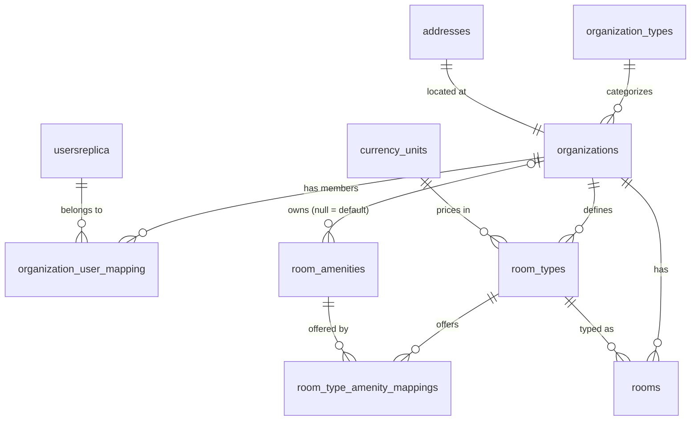

# Data and databases

Hospitia uses PostgreSQL 17 with **one database per service**. This page lists what each database holds and the rules for changing schemas.

## Databases

| Database | Service | Main tables |
|---|---|---|
| `auth` | auth | `users`, `otp` (email verification codes), `secure_token` (password reset), `users_outbox` |
| `booking` | booking | `usersreplica`, `organization_types`, `addresses`, `organizations`, `organization_user_mapping`, `currency_units`, `room_amenities`, `room_types`, `room_type_amenity_mappings`, `rooms` |
| `dashboard` | dashboard | `usersreplica` |
| `payment` | payment | `usersreplica` |

notification has no database. The databases are created by `01_create_database.sql` in `.devcontainer/postgres/docker-entrypoint-initdb.d/` (dev) and `server-setup/postgres/docker-entrypoint-initdb.d/` (production).

## Booking data model

Notable rules visible in the models:

- Records are deactivated with `is_active` (soft delete) rather than removed, and most foreign keys use `ON DELETE RESTRICT`.
- APIs expose `guid`s (`GUIDMixin`); integer `id`s are internal. `AuditMixin` adds audit columns.
- A room amenity with no organization is a **default amenity**, managed by admins and available to every organization.
- `room_types.cost_per_night` is `NUMERIC(11, 2)` with a `currency_unit_id`.
- `rooms.status` is stored as text: `AVAILABLE`, `UNDER_MAINTENANCE` or `OUT_OF_SERVICE`.
- The `currency_units` seed migration takes a subset of ISO 4217 codes from the reference file in `booking/database/reference_data/`; see [Booking service](../backend/booking.md#reference-data).

## Models and relationships

Models are SQLModel classes in `<service>/database/models/`. Every `Relationship()` must have an explicit scalar foreign-key column on the same model, with nullability and delete behaviour that match the relationship, and the constraint must be in the Alembic migration. See [Backend standards](../standards/backend.md#models-and-migrations).

## Migrations

Schema changes go through Alembic in `<service>/database/` (`alembic.ini`, `alembic/versions/`). Production containers apply migrations on startup (`jenkins/scripts/update-db.sh` runs `alembic upgrade head` before the app starts). See [Database migrations](../guides/database-migrations.md).

## Why one database per service

See [ADR 0002: Database per service with user replicas](../adr/0002-database-per-service-with-user-replicas.md).
