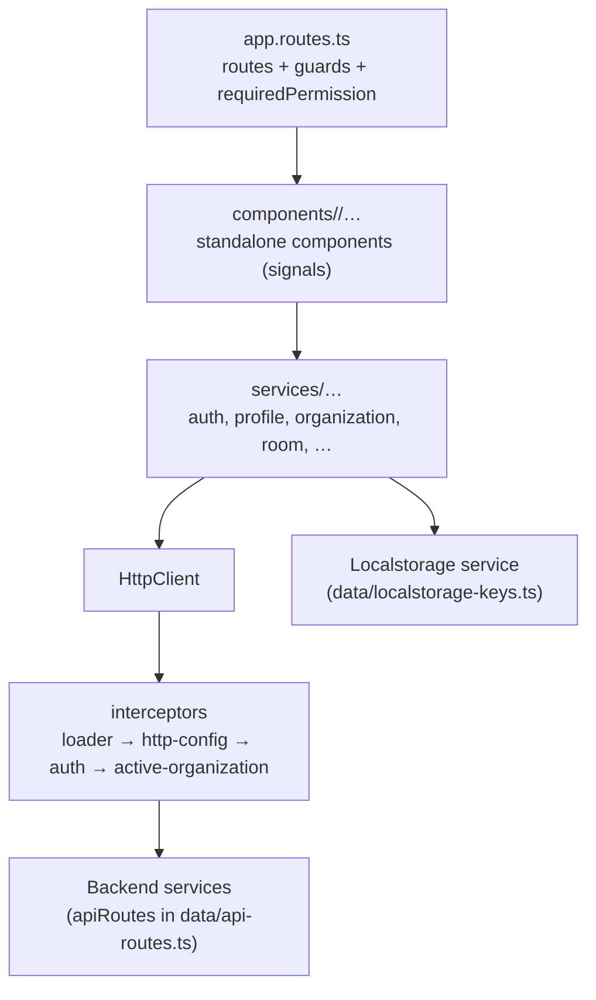

# Frontend architecture

The frontend is an Angular 21 single-page app in `hospitia-frontend/clients/main`, using Angular Material and standalone components. This page explains how it's put together; [Frontend](../frontend/index.md) covers the source layout and day-to-day work.

## Building blocks

- **Bootstrap** (`app.config.ts`): global error handler (`error/global-error-handler.ts`), router, Material form-field defaults (outline appearance, floating labels always), `HttpClient` with interceptors, and an app initializer that loads the signed-in user's profile before the first route renders.
- **Routing** (`app.routes.ts`): components are registered directly (eagerly). Guards: `authRedirectionGuard` (keeps signed-in users away from auth pages), `permissionGuard` (checks `data.requiredPermission` roles), `organizationOnboardingGuard` (lets only an owner or manager without an active organization open their onboarding page; anyone else is redirected to their default home route).
- **Interceptors** (`interceptors/`), in order:
    - `loaderInterceptor`: shows the global loading indicator (skip it per request with the `SkipLoading` context token).
    - `httpConfigInterceptor`: applies a per-request timeout when the `REQUEST_TIMEOUT` context token is set.
    - `authInterceptor`: adds `Authorization: Bearer <access token>` (skip with `IncludeAuthToken`); on a 401 it refreshes the access token once, shared by concurrent requests, and retries, or logs the user out when there's no refresh token.
    - `activeOrganizationInterceptor`: adds `X-Active-Organization-Guid` to requests to the booking service, and clears the active organization when booking answers `ACTIVE_ORGANIZATION_INVALID`.
- **State:** signals in components and services. Persistent client state (tokens, active organization, theme and accessibility preferences, sidebar state) lives in local storage under the keys in `data/localstorage-keys.ts`.
- **Constants** live in `data/`: `api-routes.ts` (every endpoint URL, built from `environment.*ServiceBaseUrl`), `app-routes.ts` (every app path), `icon-list.ts`, `sidebar-navigation.ts`, `app-constants.ts`.
- **Environments** (`src/environments/`): service base URLs, version, feature flags such as `enableOwnerSignup`, and resend and retry timings.

## Layout

Signed-in pages render inside an app shell (`components/common/app-shell`) with a collapsible, grouped sidebar (`app-sidebar`, items from `data/sidebar-navigation.ts` filtered by role) and a top bar. Public pages (landing, sign-in) use the public layout with navbar and footer, chosen by route `data` (`publicLayout`, `showNavbar`, `showFooter`).

## Internationalization

The app uses Angular's built-in i18n (`@angular/localize`). The source locale is `en-US`; translations live in `src/locale/` (`messages.hi.xlf` for Hindi). Extract new strings with the VS Code task **i18n : main-client (ng extract-i18n)**. The production nginx config serves the app under `/en-US/`.

## Theming

Material 3 theme with Hospitia brand palettes, light and dark modes and user accessibility preferences. See [Styling and theming](../frontend/styling-and-theming.md).
