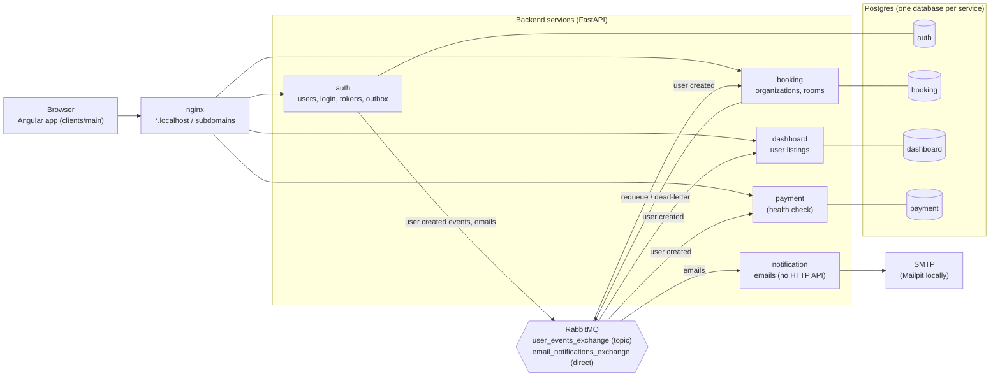

# Architecture

This section explains how Hospitia is built and why. Read it before making a change that crosses a service boundary or adds a new pattern.

## System overview

Hospitia is an Angular single-page app talking to several FastAPI services. Each service owns its own Postgres database. Services share data through events on RabbitMQ, never by reading another service's database.

## Key ideas

| Idea | Summary | Read more |
|---|---|---|
| Multi-repo workspace | `hospitia-master` holds the workspace and docs; frontend and backend are separate repositories nested inside it. | [Workspace and repositories](workspace.md) |
| Service per business area | auth, booking, dashboard, payment and notification are independent apps with their own database and deployment. | [Services](services.md) |
| Stateless JWT auth | auth issues JWTs; every service validates them with the shared secret and checks the role. | [Authentication and roles](auth-and-roles.md) |
| Events, not shared tables | auth publishes user-created events from a transactional outbox; other services keep a user replica. | [Messaging and events](messaging.md) |
| Database per service | Postgres with one database per service, schema changes through Alembic. | [Data and databases](data.md) |
| Active organization | Owners and managers work in one organization at a time, sent as a header and validated by booking. | [Active organization](active-organization.md) |
| Layered code | Routes → services → repositories → models in every backend service; components → services → API in the frontend. | [Backend](../backend/index.md), [Frontend architecture](frontend.md) |

## Decisions

The reasons behind these choices are recorded as [Architecture decision records](../adr/index.md).
