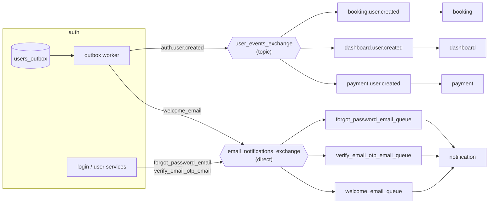

# Messaging and events

Services communicate asynchronously through RabbitMQ. This page describes the exchanges, queues and delivery guarantees. For how to add a new message flow, see [Publishing and consuming messages](../guides/messaging.md).

## The messaging abstraction

Business code never uses RabbitMQ (`pika`) directly. Each service has a `messaging/` package:

| Module | Role |
|---|---|
| `messaging/base.py` | Abstract `MQClient` (and, in consumers, `MQConsumer`) interfaces |
| `messaging/general.py` (`mq_client_general.py` in notification) | `get_mq_client()` returns the implementation chosen by `MQ_CLIENT_TYPE` |
| `messaging/mq_consumer_general.py` | `get_mq_consumer()` for services that consume |
| `messaging/rabbitmq/` | The RabbitMQ implementation: client, consumer, exchange and queue declarations |

Routes and services call `get_mq_client().publish(destination, message)`. Only `messaging/rabbitmq/` knows about RabbitMQ.

## Topology

Names are configured per service in `.env`; the values above are the sample values.

### User events

- **Exchange:** `USER_EVENTS_EXCHANGE` (`user_events_exchange`, type `topic`).
- **Event:** `USER_CREATED_EVENT_TYPE` = `auth.user.created`, routed with the same key.
- **Queues:** auth declares one durable queue per subscriber (`booking.user.created`, `dashboard.user.created`, `payment.user.created`), so events wait in the queue if a subscriber is down.
- **Envelope** (`MqDomainEvent`): `event_id`, `event_type`, `occurred_at`, `payload`, `retry_count`.
- **Payload** (`MqUserCreatedPayload`): `id`, `guid`, `email`, `username`, `first_name`, `last_name`, `role`, and for provisioned managers `organization_guid` and `created_by_guid`.

Each subscriber upserts its **user replica** (`usersreplica` table). booking also maps a newly provisioned manager to the given organization when it exists, is active, and the creator is an admin or an active owner of it; otherwise it logs a warning and skips the mapping (an admin can map the manager later).

### Email messages

- **Exchange:** `EMAIL_NOTIFICATION_EXCHANGE` (`email_notifications_exchange`, type `direct`).
- **Queues:** `forgot_password_email_queue`, `verify_email_otp_email_queue`, `welcome_email_queue`, each with a dead-letter queue.
- **Messages:** `MqForgotPasswordMessage`, `MqVerifyEmailOtpMessage`, `MqWelcomeEmailMessage` (recipient, subject, names and the message-specific fields).

## Delivery guarantees

### Transactional outbox (auth)

When auth creates a user, it writes a `users_outbox` row **in the same database transaction**. A background thread (`auth/outbox/worker.py`, started with the app) polls every `OUTBOX_POLL_INTERVAL_SECONDS` (default 2), claims up to `OUTBOX_BATCH_SIZE` (default 50) unprocessed rows, publishes the user-created event and, for provisioned users, the welcome email, then marks the row processed. If publishing fails, the row stays unprocessed and the next poll retries. Events can therefore be delivered more than once, never lost; consumers must be idempotent (the replica handler upserts).

Password-reset and OTP emails are published directly from the request, because they're tied to a user action that can simply be repeated.

### Consumer retries and dead letters

booking, dashboard, payment and notification consume with manual acknowledgement:

1. The handler for the queue runs (handlers are registered in `handlers/handler_routes.py` by queue name).
2. On success the message is acknowledged.
3. On failure, the per-queue exception handler republishes the message with `retry_count + 1` while it's below the configured limit (`USER_CREATED_RETRY_COUNT`, `*_EMAIL_RETRY_COUNT`; samples use 3), then moves it to the dead-letter queue.
4. Messages that aren't valid JSON go straight to the dead-letter queue.

Inspect dead-letter queues in the RabbitMQ management UI; see [PgAdmin, Mailpit and RabbitMQ](../guides/dev-tools.md).

## Why

See [ADR 0003: Transactional outbox in auth](../adr/0003-transactional-outbox-in-auth.md) and [ADR 0004: Messaging abstraction over RabbitMQ](../adr/0004-messaging-abstraction-over-rabbitmq.md).
