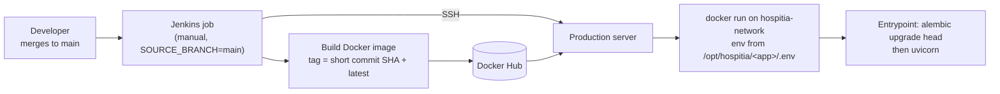

# Operations

How Hospitia is built, deployed, monitored and released. These pages are for maintainers who run the CI server and the production server.

| Page | Covers |
|---|---|
| [CI/CD with Jenkins](ci-cd.md) | The Jenkins controller, agents, jobs and the build-and-deploy pipelines |
| [Server setup and deployment](deployment.md) | Preparing the Linux server, nginx, Postgres, RabbitMQ and how services are deployed |
| [Observability](observability.md) | Logs with Grafana, Loki and Alloy; metrics plans |
| [Releasing and versioning](releasing.md) | Version numbers, the changelog and how to cut a release |

## Deployment at a glance

Everything runs on one Ubuntu/Linux server with Docker: the services, the frontend, Postgres, RabbitMQ, nginx and the observability stack.
