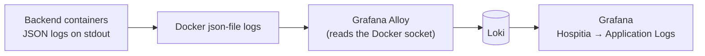

# Observability

How to see what Hospitia is doing in production. Today that means **logs**; metrics are prepared but not enabled.

## Logs

- Backend services run with `ENVIRONMENT=production` and `LOG_FORMAT=json`, so they log JSON to stdout only. Don't write log files in production.
- **Grafana Alloy** `v1.12.0` (`alloy/config.alloy`) discovers containers through the Docker socket, keeps those labelled `com.hospitia.service` with a backend service name (`auth-service`, `notification-service`, `booking-service`, `payment-service`, `dashboard-service`), adds `container` and `service` labels, and pushes their logs to Loki. The frontend container's nginx logs aren't shipped.
- **Loki** `3.5.5` (`loki/config.yaml`) stores logs for `LOKI_RETENTION_DAYS` days (default 10).
- **Grafana** `13.1.3` (port 3000, also routed as the `grafana.` subdomain) has Loki as its default data source and a provisioned dashboard **Hospitia → Application Logs** with a panel per service. Dashboards are provisioned from `grafana/provisioning/` and survive container re-creation (`grafana/data`).
- Docker JSON-file logs are rotated: infrastructure containers by `DOCKER_LOG_MAX_SIZE` / `DOCKER_LOG_MAX_FILE`, backend containers by the Jenkins `docker run` options (20 MB × 3), so container logs can't fill the disk.

Images are pinned to exact versions, never `latest`.

### Finding a request

Open Grafana at `http://<server>:3000`, sign in with `GF_SECURITY_ADMIN_USER` / `GF_SECURITY_ADMIN_PASSWORD`, then open **Hospitia → Application Logs** or **Explore → Loki**. Filter by `container` (for example `auth-service`) and search for the `X-Request-ID` returned to the client.

## Metrics (not enabled)

Prometheus `v3.5.0` is configured (`prometheus/prometheus.yml`, scrape jobs for every service on its container port) but **commented out** in `docker-compose.yml` and in Grafana's data sources, because the services don't expose a `/metrics` endpoint yet. To enable it, add `/metrics` to the services, then uncomment the `prometheus` service, the Grafana dependency on it and the Prometheus data source.

## Not deployed

Tempo, Vector, OpenTelemetry tracing and Alertmanager aren't deployed.
