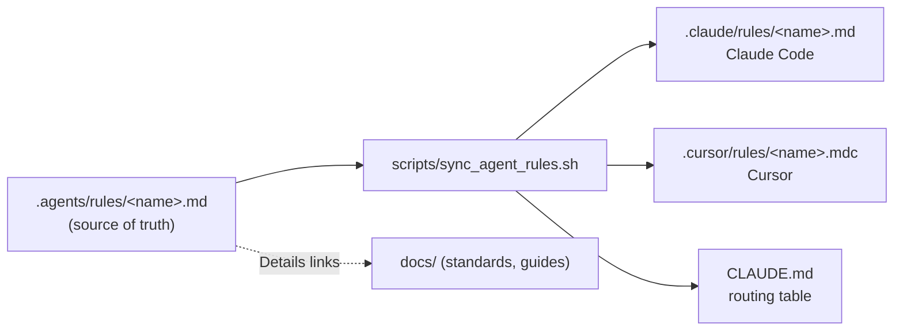

# AI coding agents

Hospitia is developed with AI coding agents (Claude Code and Cursor) alongside people. This page explains how agents get the project's rules, and how to change them. It's for maintainers and anyone editing agent instructions.

## How it works



- **One rule per area**, in `.agents/rules/`: four always-on rules (`project-overview`, `architecture`, `agent-workflow`, `cloud-sessions`) and path-scoped rules for each backend service, the database layer, Angular code, templates and styles, accessibility, and documentation.
- **Rules are short.** Each lists the must and must-not points for its area (about 20–60 lines) and ends with links to the docs pages that explain the reasons and show examples. The [Standards](index.md) pages are the source of truth; a rule that disagrees with them is a bug in the rule.
- **Generated copies.** `scripts/sync_agent_rules.sh` writes each rule in Claude Code's format (`.claude/rules/`, `paths:` frontmatter) and Cursor's format (`.cursor/rules/`, `globs` and `alwaysApply`), and regenerates the routing table in `CLAUDE.md`. Generated files carry a "GENERATED" comment; the script removes generated files whose source was deleted and never touches other files.
- **`CLAUDE.md` is small:** what Hospitia is, how rules load, the generated table of rules with their paths, and how to change rules.

Skills (reusable agent workflows such as `requirement-gathering`) follow the same pattern: source in `.agents/skills/`, copied to `.claude/skills/` by `scripts/sync_agent_skills.sh`.

## How agents load rules

| Situation | What loads |
|---|---|
| Claude Code started in `hospitia-master` (dev container, local) | `CLAUDE.md` and the always-on rules at start; each path-scoped rule when the agent reads or edits a matching file |
| Claude Code cloud session (starts in the parent folder) | `~/.claude/CLAUDE.md` (written by `scripts/cloud_env_setup.sh`) tells the agent to run the bootstrap and read `hospitia-master/CLAUDE.md`, whose instructions and table tell it to read the always-on rules and, before editing, the matching rules |
| Cursor | `.cursor/rules/*.mdc`: always-on rules always; scoped rules for matching files |

Globs are relative to `hospitia-master` (for example `backend/services/booking/**`). In cloud sessions, work through `hospitia-master/frontend` and `hospitia-master/backend` so paths match.

!!! info "Observed behaviour"
    In a Claude Code cloud session started in the parent folder (Claude Code 2.1.316, 2026-11-02), the always-on rules and the matching path-scoped rule from `hospitia-master/.claude/rules/` were loaded automatically as soon as files under `hospitia-master/` were edited. The `CLAUDE.md` instructions remain the fallback for sessions where that doesn't happen.

## Adding or changing a rule

1. Edit or create `.agents/rules/<name>.md` (kebab-case name). The format is described in `.agents/rules/README.md`:

    ```markdown
    ---
    description: Booking service - organizations, active organization, memberships and room setup
    paths:
      - "backend/services/booking/**"
    ---

    # Backend: booking service

    One sentence on what the rule covers.

    - Must / must-not bullets, key paths and commands.

    Details: `docs/backend/booking.md`
    ```

2. Omit `paths` for an always-on rule; keep the always-on rules to about 150 lines in total, since they load in every session.
3. Run `bash scripts/sync_agent_rules.sh`.
4. If the rule reflects a standard, update the [Standards](index.md) page in the same pull request.
5. `bash scripts/check_docs.sh` fails if generated files drift from their sources.

When a new backend service or frontend app is added, add a rule for it.

## Never

- Edit `.claude/rules/`, `.cursor/rules/` or the table in `CLAUDE.md` by hand.
- Put secrets or `.env` values in rules.
- Copy whole explanations from docs into rules; link to them.
